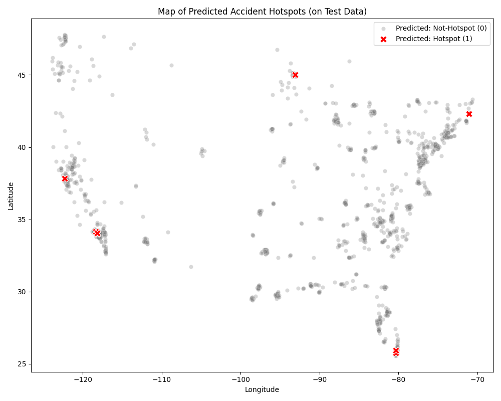
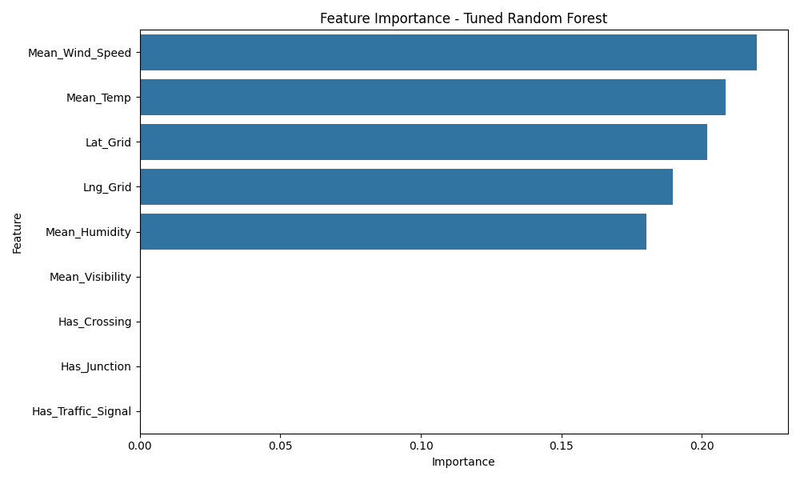
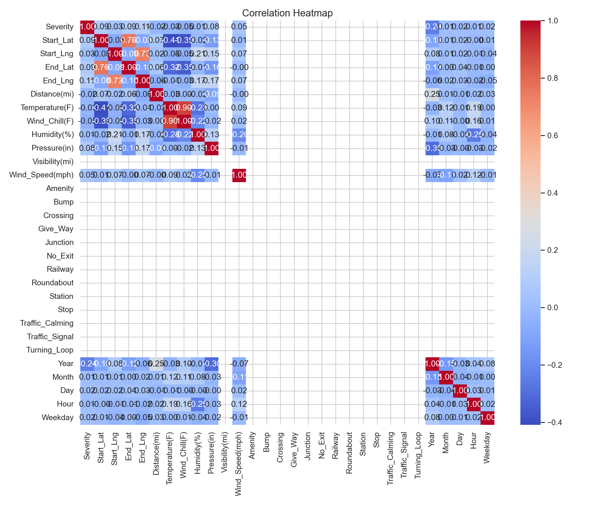
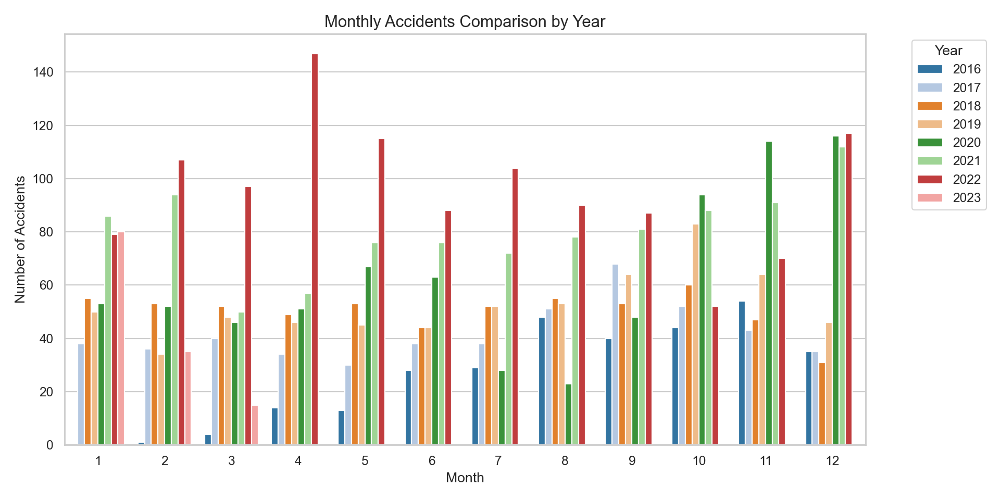

# 🚦 Predicting High-Risk Traffic Accident Locations Using Data Mining

An end-to-end data mining project that turns raw U.S. traffic accident records into a model that predicts **accident hotspots**, meaning geographic areas with an elevated risk of repeated accidents.

> Course project for **CIS 517: Data Mining and Data Warehousing**, Imam Abdulrahman Bin Faisal University (IAU).
> Project lead: **Renad Alkahtani**

---

## 📌 The idea in one paragraph

Most accident analysis only describes where accidents *already* happened. This project goes one step further. It combines location, weather, road infrastructure and time-of-day data to predict **which areas are likely to be high-risk**, so authorities can place resources (signals, patrols, road fixes) *before* accidents happen. The work follows the **CRISP-DM** process: data understanding, preparation, exploratory analysis, modeling and evaluation.

## 🎯 Objectives

- Build a clean, structured pipeline for collecting and preparing accident data.
- Explore temporal, weather, geographic and road patterns behind accidents.
- Classify accident severity from influential variables.
- Predict **hotspot locations** using a grid-based spatial model.
- Compare several models and explain which factors drive risk.

## 🗂️ Dataset

| | |
|---|---|
| **Source** | [US Accidents (March 2023)](https://www.kaggle.com/datasets/sobhanmoosavi/us-accidents) on Kaggle, by Sobhan Moosavi et al. |
| **Sample used** | 10k-record sample → **7,208 rows × 46 columns** after cleaning |
| **Train / Test split** | 5,045 / 2,163 rows |
| **Key features** | Location (lat/lng, city, state), weather (temperature, humidity, visibility, wind), road infrastructure (junction, signal, crossing, stop…), time (hour, weekday, month, twilight) and `Severity` (1–4) |

The original dataset is licensed **CC BY-NC-SA 4.0** and is used here for non-commercial, educational purposes only.

## 🔄 Project pipeline

```
Raw data ──► Phase 3: Cleaning & Transformation ──► Phase 4: EDA ──► Phase 5: Modeling & Evaluation
  (Kaggle)     missing values, outliers,              130+ charts,        Decision Tree, Logistic Regression,
               encoding, train/test split            audit report         Random Forest, Gradient Boosting
```

### Phase 3: Data preparation
- Fixed structural header misalignment and corrupted categorical values.
- Removed duplicates, imputed missing values and handled extreme outliers.
- Converted 13 boolean road-feature columns and 3 datetime columns into numeric features.
- Split the data into training and test sets (70/30).

### Phase 4: Exploratory data analysis (EDA)
- Descriptive statistics (mean, median, variance, mode…) for every numeric feature.
- Histograms, boxplots, scatter plots and count plots for every column, plus per-year comparisons.
- Correlation heatmap, plus monthly, hourly and weekday accident trends.
- A full written **EDA audit report** summarizing data quality and key insights.

### Phase 5: Modeling
1. **Decision Tree:** predicts accident severity (1–4).
2. **Advanced Logistic Regression:** hotspot prediction with interpretable odds ratios.
3. **Random Forest & Gradient Boosting:** accidents are grouped into **geographic grid cells**, and a cell is labeled a *hotspot* if it has more than one accident. Both models are tuned with `GridSearchCV`.
4. **XGBoost (extra experiment):** the same grid-cell setup, with `scale_pos_weight` to pay more attention to the rare hotspot class.

### 📈 Interactive dashboard
A **Streamlit** dashboard to explore the data yourself: upload the Excel file, filter by year and weather, and browse histograms, box plots, time trends, weather vs severity, and a map of accident locations. You can also download an EDA audit report.

## 📊 Results

Final comparison on the test set for hotspot prediction (Hotspot = 1 is the positive class):

| Model | Accuracy | Precision | Recall | F1 |
|---|---|---|---|---|
| Logistic Regression | 0.86 | 0.97 | 0.89 | 0.92 |
| Random Forest (tuned) | 0.92 | 0.88 | 0.06 | 0.11 |
| **Gradient Boosting (tuned)** ⭐ | **0.94** | **0.98** | **0.38** | **0.54** |

On the grid-cell hotspot task, **tuned Gradient Boosting** was the strongest model. When it flags an area as a hotspot it is right **98%** of the time, and it finds 38% of all real hotspots, even though only ~8.9% of cells are hotspots. The Logistic Regression experiment used a separate engineered feature set; see [its results file](phase5_modeling/results/advanced_logistic_regression_results_final.txt).

#### 🧪 Extra experiment: XGBoost
After the final report, the grid-cell models were also run with **XGBoost**:

| Model | Accuracy | Precision | Recall | F1 |
|---|---|---|---|---|
| XGBoost (baseline) | 0.94 | 0.72 | **0.60** | **0.65** |
| XGBoost (tuned) | 0.93 | 0.70 | 0.48 | 0.57 |

XGBoost finds many more of the real hotspots (**60%** vs 38%) and has the best F1 overall, but it is less precise (72% vs 98%). So the choice depends on the goal. Gradient Boosting is better when false alarms are costly, and XGBoost is better when missing a dangerous area is costly. Full output is in [`results/xgboost/`](phase5_modeling/results/xgboost/model_audit_report.txt). Exact numbers can shift slightly with different library versions.

The Decision Tree severity classifier reached **76% accuracy** but struggled with rare severity levels (1 and 4). This is a direct effect of class imbalance.

### 🔑 Key findings
- **Location is the strongest signal.** Grid latitude/longitude were the top predictors, so accident risk is highly location-specific.
- **Weather matters.** Low visibility, high humidity and stronger wind are associated with hotspots.
- **Road infrastructure matters.** Traffic signals, crossings and junctions appear repeatedly in high-risk cells.
- **Accuracy is misleading on imbalanced data.** Tuning for accuracy made Random Forest *ignore* hotspots. Future work should optimize for recall/F1 and use resampling (e.g. SMOTE).

<p align="center">
  
  
</p>
<p align="center">
  
  
</p>

## 📁 Repository structure

```
.
├── reports/                          # Full written reports for every phase (PDF)
│   ├── 01_project_proposal.pdf
│   ├── 02_phase2_part1.pdf           # Data collection
│   ├── 03_phase2_part2.pdf
│   ├── 04_phase4.pdf                 # EDA
│   ├── 05_phase5.pdf                 # Modeling
│   └── 06_final_report.pdf           # ⭐ Complete final report (all phases)
│
├── data/
│   ├── US_Accidents_March23_sampled_10k_cleaned.xlsx   # Cleaned sample
│   ├── transformed_data_train_V88.xlsx                 # Training set
│   ├── transformed_data_test_V88.xlsx                  # Test set
│   ├── transformed_data_summary_V88.xlsx               # Split summary
│   └── transformed_data_train_formatted.xlsx           # Styled version for viewing
│
├── phase3_data_preparation/
│   ├── 01_data_cleaning.ipynb
│   ├── 02_transformation_and_splitting.py
│   └── 03_excel_formatting.py
│
├── phase4_eda/
│   ├── 01_descriptive_statistics.ipynb
│   ├── 02_eda_visualizations.py      # Generates all charts in figures/
│   ├── descriptive_stats_summary.xlsx
│   ├── EDA_audit_report.txt
│   └── figures/                      # 136 charts
│
├── dashboard/
│   └── streamlit_dashboard.py        # Interactive data dashboard
│
└── phase5_modeling/
    ├── 01_decision_tree.ipynb
    ├── 01_decision_tree_colab.ipynb  # Google Colab version
    ├── 02_advanced_logistic_regression.ipynb
    ├── 03_hotspot_rf_gb.py           # Grid hotspots + Random Forest + Gradient Boosting
    ├── 04_model_comparison.py        # Final model comparison charts
    ├── 05_hotspot_xgboost.py         # Extra experiment: adds XGBoost to the hotspot models
    ├── figures/                      # (xgboost/ holds the XGBoost run's charts)
    └── results/                      # Metrics, audit reports, full predictions (+ xgboost/)
```

> 📖 **New here?** Start with [`reports/06_final_report.pdf`](reports/06_final_report.pdf). It explains every step in detail.

## ▶️ How to run

```bash
git clone https://github.com/RenadQ/traffic-accident-hotspot-prediction.git
cd traffic-accident-hotspot-prediction
pip install -r requirements.txt
```

The scripts read their input files by name from the current folder, so run them from inside `data/` (or copy the needed `.xlsx` file next to the script):

```bash
cd data
python ../phase3_data_preparation/02_transformation_and_splitting.py   # cleaning → train/test split
python ../phase4_eda/02_eda_visualizations.py                         # all EDA charts
python ../phase5_modeling/03_hotspot_rf_gb.py                         # hotspot models
python ../phase5_modeling/05_hotspot_xgboost.py                       # + XGBoost
```

To open the interactive dashboard, run this from the project root, then upload `data/transformed_data_train_V88.xlsx` in the browser:

```bash
streamlit run dashboard/streamlit_dashboard.py
```

The notebooks can be opened in Jupyter or Google Colab.

## 🛠️ Tech stack

Python · pandas · NumPy · scikit-learn · XGBoost · matplotlib · seaborn · Plotly · Streamlit · openpyxl · Jupyter / Google Colab

---

<details>
<summary>🇸🇦 ملخص بالعربي</summary>

مشروع تنقيب بيانات يهدف إلى **التنبؤ بالمواقع عالية الخطورة لحوادث المرور** باستخدام بيانات حوادث الولايات المتحدة (Kaggle). مرّ المشروع بمراحل CRISP-DM: تنظيف البيانات وتحويلها، ثم التحليل الاستكشافي (أكثر من 130 رسم بياني)، ثم بناء نماذج Decision Tree وLogistic Regression وRandom Forest وGradient Boosting.

أفضل نموذج كان **Gradient Boosting** بعد الضبط: دقة تنبؤ بالنقاط الساخنة **98%** واسترجاع 38%. وأهم النتائج أن الموقع الجغرافي هو أقوى مؤشر للخطر، وأن ضعف الرؤية والرطوبة والرياح، وكذلك الإشارات والتقاطعات، كلها مرتبطة بالمناطق الخطرة.

التقرير الكامل موجود في `reports/06_final_report.pdf`.
</details>
